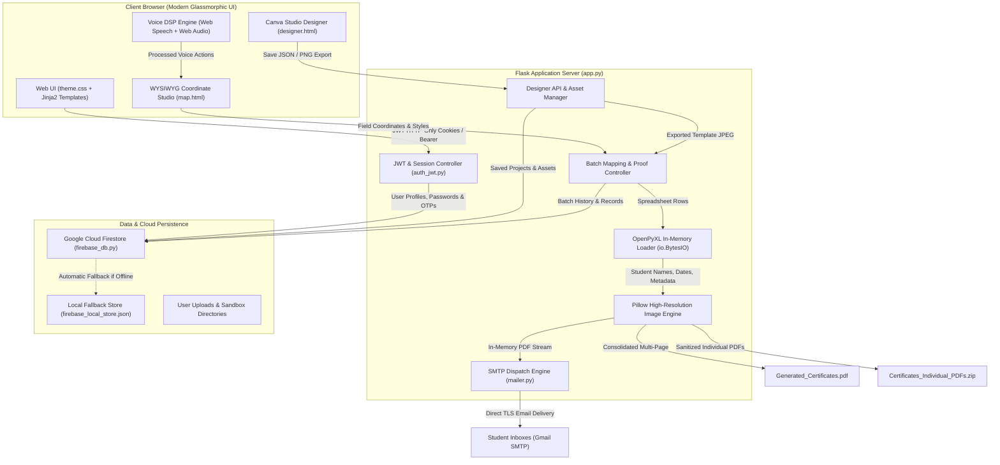

# 📜 Certificate Studio Pro

> **Enterprise-Grade Certificate Generation, Visual Canvas Designer, Voice-Controlled Editing & Automated Multi-Channel Dispatch System.**

[](https://www.python.org/)
[](https://flask.palletsprojects.com/)
[](https://firebase.google.com/)
[](https://jwt.io/)
[](https://support.google.com/mail)
[-brightgreen.svg)]()

---

## 🌟 Table of Contents
- [Project Overview](#-project-overview)
- [System Architecture](#-system-architecture)
- [Dual Design & Generation Workflows](#-dual-design--generation-workflows)
  - [Workflow A: Canva-Style Visual Certificate Studio](#workflow-a-canva-style-visual-certificate-studio)
  - [Workflow B: Batch Mapping & Voice Studio](#workflow-b-batch-mapping--voice-studio)
- [Multi-Channel Export & Distribution](#-multi-channel-export--distribution)
- [Voice-Command Editor & Audio DSP Engine](#-voice-command-editor--audio-dsp-engine)
- [Security, Authentication & Recovery](#-security-authentication--recovery)
- [Project Directory Structure](#-project-directory-structure)
- [Complete Route & API Reference](#-complete-route--api-reference)
- [Installation & Local Setup](#-installation--local-setup)
- [Configuration (.env & Firebase)](#-configuration-env--firebase)
- [Running the Application](#-running-the-application)
- [Automated Verification & Test Suites](#-automated-verification--test-suites)
- [Troubleshooting & FAQs](#-troubleshooting--faqs)
- [License](#-license)

---

## 🚀 Project Overview

**Certificate Studio Pro** is a comprehensive, production-ready certificate creation, design, and issuance platform built with Flask, Pillow, and Google Cloud Firestore. It eliminates manual graphic design effort and brittle coordinate scripts by giving organizations two fluid workflows:

1. **Canva-Style Visual Studio (`/create-certificate` / `/designer`)**: Build certificate artwork from scratch or choose from **1,000+ catalog templates** across 10 distinct categories. Add gold wax seals, ribbons, verified star badges, custom uploaded logos, and signatures. Save designs to cloud storage, or push them directly into the bulk generation pipeline with one click.
2. **Classic Batch Mapping & Voice Studio (`/studio` & `/map`)**: Upload any certificate design (`.jpg`, `.png`) alongside an Excel sheet (`.xlsx`, `.xls`). Visually position dynamic student data placeholders with mouse or **hands-free voice commands**, inspect live student proofs, and export thousands of certificates.
3. **Multi-Channel Distribution**:
   - 📄 **Merged PDF**: Single multi-page document containing all certificates.
   - 📦 **Individual PDFs in ZIP**: Cleanly sanitized individual files (*e.g., `Certificate_Priya_Sundaram.pdf`*) packaged in a single ZIP.
   - ✉️ **Direct Bulk Email Delivery**: Automated dispatch to recipient inboxes via Gmail SMTP with dynamic `{Name}` personalization and in-memory PDF attachment generation.
4. **Resilient Cloud Persistence**: Seamless dual-mode database with **Google Cloud Firestore** and automatic offline fallback to **Local JSON Store** (`firebase_local_store.json`).
5. **Robust Security**: Signed **JWT authentication** stored in secure HTTP-only cookies, Werkzeug password hashing, **Email OTP registration**, and **Email OTP self-service password recovery**.

---

## 🏗 System Architecture



---

## 🔄 Dual Design & Generation Workflows

```
┌────────────────────────────────────────────────────────────────────────┐
│                          AUTHENTICATION                                │
│       /register (Email OTP)  ───►  /login  ───►  /dashboard            │
└───────────────────────────────────┬────────────────────────────────────┘
                                    │
         ┌──────────────────────────┴──────────────────────────┐
         ▼                                                     ▼
┌─────────────────────────────────┐   ┌─────────────────────────────────┐
│  WORKFLOW A: CANVA DESIGNER     │   │  WORKFLOW B: BATCH MAPPING      │
│  (/create-certificate)          │   │  (/studio & /map)               │
├─────────────────────────────────┤   ├─────────────────────────────────┤
│ • 1,000+ Categorized Templates  │   │ • Upload Custom Template &      │
│ • Custom Canvas Dimensions      │   │   Excel Spreadsheet             │
│ • Ribbons, Wax Seals & Badges   │   │ • Zero-Lock Memory Parsing      │
│ • Upload Custom Logos/Signature │   │ • Visual Coordinate Mapper      │
│ • Cloud Save (/api/save-design) │   │ • Voice-Controlled Styling      │
│ • "Use for Bulk Generation" ───►│───► • Dynamic Font Auto-Fitting     │
└─────────────────────────────────┘   │ • Live Participant Proof Review │
                                      └────────────────┬────────────────┘
                                                       │
                                      ┌────────────────┴────────────────┐
                                      ▼                                 ▼
                         ┌────────────────────────┐       ┌────────────────────────┐
                         │  DOWNLOAD EXPORTS      │       │  AUTOMATED EMAIL       │
                         │  • Merged PDF          │       │  • Bulk Gmail SMTP     │
                         │  • Individual PDFs ZIP │       │  • {Name} Substitution │
                         └────────────────────────┘       └────────────────────────┘
```

---

### Workflow A: Canva-Style Visual Certificate Studio

Accessible via `/create-certificate` or `/designer`:

1. **Template Catalog**:
   - Browse **1,000 pre-designed certificate templates** across 10 categories: Event, Workshop, Course, Hackathon, Corporate, Academic, Sports, Volunteering, Internship, and Achievement.
   - Filter templates by category or search by keywords.
2. **Flexible Canvas Configurations**:
   - Choose standard dimensions: **A4 Landscape** (`1050x742`), **A4 Portrait** (`742x1050`), **US Letter**, **Square / Social** (`1080x1080`), or enter custom pixel dimensions.
3. **Rich Vector & Graphic Elements**:
   - Add luxury borders (Double Gold, Vintage Baroque, Modern Corner, Neon Glow).
   - Place vector insignias: Gold Wax Seals, Rosettes, Excellence Badges, Verified Star Badges, Ribbons, and QR Codes.
   - Upload custom institution logos and signature PNGs directly from your machine (`/api/upload-designer-asset`).
4. **Cloud Persistence**:
   - Click **Save Design** to store design JSON state and preview thumbnails directly in Google Cloud Firestore (`/api/save-design`).
   - Access saved designs anytime under the **Saved Canva Projects** tab on `/dashboard`.
5. **One-Click Bulk Generation Handoff**:
   - Click **"Use for Bulk Generation"**. The canvas renders to a high-resolution JPEG, stores it in the user's active session via `/api/export-designer-template`, and redirects directly into the Excel mapping pipeline!

---

### Workflow B: Batch Mapping & Voice Studio

Accessible via `/studio` and `/map`:

1. **Upload Template & Spreadsheet**:
   - Upload your certificate image (`.jpg`, `.png`) and Excel file (`.xlsx`, `.xls`).
   - The server ingests the spreadsheet in memory (`io.BytesIO`) to guarantee zero Windows/OneDrive file locking.
2. **Visual Mapping Canvas (`/map`)**:
   - Text bounding boxes for every column header (`Name`, `Department`, `College`, `Date`, etc.) are overlaid on the template preview.
   - Drag, place, and resize bounding boxes with mouse handles.
   - Select typography: Font Family (Cinzel, Montserrat, Great Vibes, Playfair Display, Outfit, etc.), Font Size, Color (via color picker), Alignment (Left, Center, Right), Case Transformation (Uppercase, Lowercase, Title Case), Bold, Italic, and Underline.
3. **Dynamic Font Auto-Fitting**:
   - Long student names automatically step down in font size using bounding-box measurement calculations (`draw.textbbox`). Text never clips, overlaps, or runs off page margins.
4. **Hands-Free Voice Studio**:
   - Toggle the microphone button to activate the **Voice Control HUD**.
   - Speak styling commands directly to modify selected fields instantly.
5. **Live Proofing (`/preview`)**:
   - Click **"Generate Live Sample Proof"**.
   - Pillow renders the first actual record from your spreadsheet onto the canvas. Inspect the proof for spacing, contrast, and alignment before initiating the full batch run.

---

## 📦 Multi-Channel Export & Distribution

Once mapped and proofed, choose your preferred export or delivery channel:

```
                          ┌───────────────────────────┐
                          │    /preview-sample        │
                          └─────────────┬─────────────┘
                                        │
         ┌──────────────────────────────┼──────────────────────────────┐
         ▼                              ▼                              ▼
┌───────────────────┐        ┌───────────────────┐        ┌───────────────────┐
│  /generate-final  │        │   /generate-zip   │        │/dispatch-bulk-mail│
│   (Merged PDF)    │        │  (Individual ZIP) │        │   (SMTP Direct)   │
├───────────────────┤        ├───────────────────┤        ├───────────────────┤
│ • Consolidates    │        │ • Renders clean   │        │ • Maps email col  │
│   all students    │        │   PDF for each    │        │ • In-memory PDF   │
│   into a single   │        │   student record  │        │   attachment      │
│   sequential      │        │ • Auto dedupe &   │        │ • {Name} tags     │
│   document        │        │   sanitized names │        │ • Gmail SMTP TLS  │
└───────────────────┘        └───────────────────┘        └───────────────────┘
```

1. **Merged Multi-Page PDF (`/generate-final`)**:
   - Compiles all student certificates into a single consolidated PDF (`Generated_Certificates.pdf`). Ideal for print shops or physical certificate printing.
2. **ZIP Archive of Individual PDFs (`/generate-zip`)**:
   - Iterates through the spreadsheet, generating a standalone, pristine PDF for each student.
   - Filenames are sanitized (e.g., `Certificate_Priya_Sundaram.pdf`), with collision handling (`_2.pdf`) for duplicate names.
   - Bundles all files into `Certificates_Individual_PDFs.zip`.
3. **Direct Bulk Email Dispatch (`/dispatch-bulk-emails`)**:
   - Select the Excel column containing recipient email addresses.
   - Customize email subject line and HTML body with `{Name}` dynamic substitution tags.
   - The engine generates each participant's certificate in memory and dispatches it directly to their inbox using Gmail SMTP TLS, logging generation history to Firestore.

---

## 🎙 Voice-Command Editor & Audio DSP Engine

The Visual Mapping Studio (`templates/map.html`) features a voice-control engine pairing the **Web Speech API** with real-time **Web Audio API Digital Signal Processing (DSP)**:

```
[Microphone Audio Input]
           │
           ▼
[BiquadFilterNode: High-Pass 85 Hz]     ──> (Eliminates low-end table thumps and AC hum)
           │
           ▼
[BiquadFilterNode: Peaking 2.5 kHz]     ──> (Boosts speech clarity and vocal presence)
           │
           ▼
[Dynamic Noise Gate Subsystem]          ──> (Mutes ambient background noise below threshold)
           │
           ▼
[Web Speech Recognition Engine]         ──> [Command Parser] ──> [Canvas Action & Chime]
```

### Voice Command Reference:

| Category | Voice Commands | Example Phrasing |
| :--- | :--- | :--- |
| **Typography** | `font <name>` | *"font cinzel"*, *"font times new roman"*, *"font montserrat"* |
| **Text Styling** | `make bold`, `make italic`, `underline` | *"make bold"*, *"italic"*, *"underline text"* |
| **Font Size** | `size <number>`, `font size <number>` | *"size 48"*, *"font size 60"*, *"size 32"* |
| **Colors** | `color <name/hex>` | *"color gold"*, *"color navy"*, *"color white"*, *"color crimson"* |
| **Alignment** | `align left`, `align center`, `align right` | *"align center"*, *"align left"*, *"align right"* |
| **Positioning** | `center horizontally`, `center vertically` | *"center horizontally"*, *"center vertically"* |
| **Text Transform** | `uppercase`, `lowercase`, `title case` | *"make uppercase"*, *"title case"*, *"lowercase"* |
| **Studio Actions** | `duplicate`, `delete`, `undo`, `redo` | *"duplicate"*, *"delete field"*, *"undo"*, *"redo"* |

---

## 🔐 Security, Authentication & Recovery

### 1. Dual Authentication Modes
- **HTTP-Only Cookies (`access_token`)**: Browsers store signed JWT tokens in `HttpOnly; SameSite=Lax` cookies to prevent XSS credential theft.
- **Bearer Tokens**: REST API clients can pass tokens in the `Authorization: Bearer <token>` header for programmatic automation.
- Decorated with `@jwt_required` across all protected routes.

### 2. Dual-Identifier Login (`/login`)
- Users can log in using either their **Registered Email Address** or **Mobile Number** alongside their password.
- Passwords are encrypted using Werkzeug's secure hash algorithm (`scrypt` / `pbkdf2:sha256`).

### 3. Email OTP Registration Flow (`/register`)
- Enter Name, Mobile Number, and Email.
- System validates inputs and generates a secure **6-digit One-Time Password (OTP)**.
- OTP is delivered to the user's email inbox via Gmail SMTP.
- Verifying the code finalizes account creation and issues a JWT session.

### 4. Self-Service Forgot Password Recovery (`/forgot-password`)
- Forgot password page allows entering either registered Email or Mobile Number.
- If a mobile number is entered, the system automatically resolves the linked user account and routes the 6-digit OTP to their registered email address (with email masking, e.g. `jo*****@example.com`).
- Upon entering the OTP and a new password (min 6 chars), the system updates the password hash in the database, invalidates the previous password, and allows immediate login.

---

## 📁 Project Directory Structure

```
CertificateGenerator/
├── app.py                         # Main Flask application controller & all HTTP endpoints
├── auth_jwt.py                    # JWT token issuance, decoding & @jwt_required decorator
├── firebase_db.py                 # Google Cloud Firestore & local JSON storage abstraction
├── mailer.py                      # Gmail SMTP dispatcher (OTP, bulk mailing & connection tester)
├── bulk_generate.py               # Standalone batch generation demonstration script
├── generate.py                    # Standalone single certificate generation script
├── generate_catalog_data.py       # Generator for 1,000 catalog templates across 10 categories
│
├── static/                        # Static web assets & design system
│   ├── theme.css                  # Master animated dark glassmorphic design system
│   ├── certificate_catalog.js     # 1,000 pre-built certificate designs & templates
│   ├── template.jpg               # Default fallback certificate template image
│   ├── sample_preview.png         # Generated sample preview cache
│   └── avatar_*.jpg               # Uploaded user profile avatars
│
├── templates/                     # Jinja2 HTML views
│   ├── header.inc.html            # Shared glassmorphic navigation header
│   ├── index.html                 # Upload portal for template & Excel spreadsheet
│   ├── designer.html              # Canva-style visual certificate studio & catalog
│   ├── map.html                   # Interactive visual WYSIWYG canvas & voice studio
│   ├── preview.html               # Live proof inspection & export action center
│   ├── dashboard.html             # User statistics, saved Canva designs & batch history
│   ├── login.html                 # Universal login (Email or Mobile + Password)
│   ├── register.html              # OTP registration flow with email confirmation
│   ├── forgot_password.html       # Self-service OTP password recovery portal
│   └── account_settings.html      # Profile, avatar upload & password management
│
├── uploads/                       # User-specific project uploads (sandboxed by user_id)
│
├── test_auth_firebase.py          # Automated verification for JWT & Firestore
├── test_otp_registration.py       # Integration tests for OTP registration & login
├── test_forgot_password.py        # Automated test suite for OTP password reset (11 tests)
├── test_designer_flow.py          # Verification for Canva designer & bulk handoff
├── test_zip_generation.py         # Verification for individual PDFs & ZIP packaging
├── test_email_dispatch.py         # Unit tests for SMTP dispatch & regex validation
├── test_voice_editor.py           # Verification for Voice HUD & Web Audio DSP filters
│
├── .env                           # Environment configuration (credentials & secrets)
├── .env.example                   # Template for environment configuration
├── firebase_credentials.json      # Google Cloud Service Account credentials
├── firebase_local_store.json      # Local fallback database store
├── requirements.txt               # Python package dependencies
├── students.xlsx                  # Sample participant spreadsheet
└── template.jpg                   # Sample certificate design template
```

---

## 📡 Complete Route & API Reference

### Page Views

| Endpoint | Method | Auth | Description |
| :--- | :--- | :--- | :--- |
| `/` | `GET` | Public | Root redirect: routes to `/dashboard` if logged in, else `/login`. |
| `/login` | `GET`, `POST` | Public | Universal login with Email or Mobile + Password. |
| `/register` | `GET` | Public | User registration portal with email OTP verification. |
| `/forgot-password` | `GET` | Public | Password recovery portal. |
| `/dashboard` | `GET` | `@jwt_required` | User statistics, saved Canva projects gallery & batch audit trail. |
| `/create-certificate` | `GET` | `@jwt_required` | Canva-style certificate designer studio (alias: `/designer`). |
| `/studio` | `GET`, `POST` | `@jwt_required` | File upload portal for custom certificate template and Excel data. |
| `/map` | `GET` | `@jwt_required` | Interactive visual coordinate mapper and voice-controlled editor. |
| `/preview-sample` | `GET` | `@jwt_required` | Live proof review showing actual student data stamped on template. |
| `/account-settings` | `GET` | `@jwt_required` | Profile management, avatar upload, and password update. |
| `/logout` | `GET` | `@jwt_required` | Clears JWT cookies and session, redirects to `/login`. |

### API Endpoints

| Endpoint | Method | Auth | Description |
| :--- | :--- | :--- | :--- |
| `/api/send-registration-otp` | `POST` | Public | Generates and emails a 6-digit OTP for account registration. |
| `/verify-register` | `POST` | Public | Validates registration OTP and creates user in database. |
| `/api/send-forgot-password-otp` | `POST` | Public | Resolves email/mobile and sends password recovery OTP. |
| `/api/reset-password` | `POST` | Public | Verifies recovery OTP and updates user's password hash. |
| `/api/save-design` | `POST` | `@jwt_required` | Saves a Canva design JSON and thumbnail to Firestore. |
| `/api/my-designs` | `GET` | `@jwt_required` | Returns list of saved Canva projects for current user. |
| `/api/delete-design/<id>` | `DELETE` | `@jwt_required` | Deletes a saved Canva project from the database. |
| `/api/export-designer-template`| `POST` | `@jwt_required` | Exports Canva design as template JPEG and loads into studio session. |
| `/api/upload-designer-asset` | `POST` | `@jwt_required` | Uploads custom logo, signature, or emblem for the canvas. |
| `/designer-asset/<user>/<file>`| `GET` | `@jwt_required` | Serves uploaded designer assets securely. |
| `/api/user/status` | `GET` | `@jwt_required` | Validates JWT token and returns user profile and DB status. |
| `/update-profile` | `POST` | `@jwt_required` | Updates user full name, mobile, and avatar image. |
| `/send-test-email` | `POST` | `@jwt_required` | Sends a live diagnostic test email to verify SMTP credentials. |
| `/dispatch-bulk-emails` | `POST` | `@jwt_required` | Generates individual certificates and emails them to all recipients. |
| `/generate-final` | `POST` | `@jwt_required` | Downloads a consolidated merged multi-page PDF. |
| `/generate-zip` | `POST` | `@jwt_required` | Downloads all individual certificates packaged in a ZIP archive. |

---

## 💻 Installation & Local Setup

### 1. Clone the Repository
```powershell
git clone <repository-url>
cd CertificateGenerator
```

### 2. Verify or Create Python Virtual Environment
```powershell
python -m venv venv
```

### 3. Activate the Virtual Environment
- **Windows (PowerShell)**:
  ```powershell
  .\venv\Scripts\Activate.ps1
  ```
  *(If execution policies restrict script activation, run: `Set-ExecutionPolicy -Scope Process -ExecutionPolicy Bypass`)*
- **Windows (Command Prompt)**:
  ```cmd
  venv\Scripts\activate.bat
  ```
- **macOS / Linux**:
  ```bash
  source venv/bin/activate
  ```

### 4. Install Dependencies
```powershell
pip install -r requirements.txt
```

*(Packages: `Flask`, `openpyxl`, `Pillow`, `python-dotenv`, `PyJWT`, `firebase-admin`, `werkzeug`)*

---

## ⚙️ Configuration (.env & Firebase)

Copy `.env.example` to `.env`:
```powershell
cp .env.example .env
```

### Environment Variables (.env):
```ini
# Flask & Security
FLASK_SECRET_KEY=your_super_secret_flask_key
JWT_SECRET_KEY=your_jwt_signature_secret_key
JWT_EXPIRATION_HOURS=24

# Firebase Configuration
FIREBASE_CREDENTIALS_PATH=firebase_credentials.json

# Gmail SMTP Configuration (For Email Dispatch & OTPs)
SMTP_SERVER=smtp.gmail.com
SMTP_PORT=587
SMTP_USE_TLS=True
SMTP_EMAIL=your-email@gmail.com
SMTP_PASSWORD=abcd efgh ijkl mnop
SMTP_SENDER_NAME=Certificate Studio Pro
```

> **📌 Obtaining a Gmail App Password:**
> 1. Open your [Google Account Security Settings](https://myaccount.google.com/security).
> 2. Ensure **2-Step Verification** is turned ON.
> 3. Search for **App passwords**.
> 4. Create an app password named `Certificate Studio` and copy the generated 16-character code into `SMTP_PASSWORD` in your `.env`.

> **🔥 Google Cloud Firestore Setup:**
> - Download your Service Account private key JSON from the Firebase Console (*Project Settings > Service Accounts > Generate new private key*).
> - Place the JSON file as `firebase_credentials.json` in the root project folder.
> - **Zero-Config Fallback**: If `firebase_credentials.json` is omitted or contains placeholder values, Certificate Studio Pro automatically runs on `firebase_local_store.json` without failing.

---

## 🏃 Running the Application

### Method 1: Using the virtual environment executable directly (Recommended)
```powershell
.\venv\Scripts\python.exe app.py
```

### Method 2: From an activated terminal
```powershell
.\venv\Scripts\Activate.ps1
python app.py
```

Open your browser and navigate to:
👉 **[http://127.0.0.1:5000](http://127.0.0.1:5000)**

---

## 🧪 Automated Verification & Test Suites

Certificate Studio Pro includes seven independent test suites covering all major subsystems. All test suites can be executed with a single command:

```powershell
# Run all unit tests
.\venv\Scripts\python.exe -m unittest discover -s . -p "test_*.py"
```

### Individual Test Suites:

| Test Suite | Purpose | Command |
| :--- | :--- | :--- |
| **`test_auth_firebase.py`** | Verifies password hashing, Firestore CRUD, JWT generation & status API. | `.\venv\Scripts\python.exe test_auth_firebase.py` |
| **`test_otp_registration.py`** | Tests input validation, 6-digit registration OTP, and dual login (email/mobile). | `.\venv\Scripts\python.exe test_otp_registration.py` |
| **`test_forgot_password.py`** | 11-step verification of OTP password recovery, hash updates, and login validation. | `.\venv\Scripts\python.exe test_forgot_password.py` |
| **`test_designer_flow.py`** | Tests Canva designer studio, project save/load, asset upload, and bulk handoff. | `.\venv\Scripts\python.exe test_designer_flow.py` |
| **`test_zip_generation.py`** | Verifies Pillow canvas rendering, participant name extraction, and ZIP creation. | `.\venv\Scripts\python.exe test_zip_generation.py` |
| **`test_email_dispatch.py`** | Tests email regex validation, MIME multi-part attachments, and SMTP dispatch. | `.\venv\Scripts\python.exe test_email_dispatch.py` |
| **`test_voice_editor.py`** | Verifies Web Speech recognition hooks, Web Audio DSP noise filters, and voice HUD. | `.\venv\Scripts\python.exe test_voice_editor.py` |

---

## ❓ Troubleshooting & FAQs

### 1. `ModuleNotFoundError: No module named 'dotenv'`
**Cause**: The application was executed with the global system Python rather than the virtual environment.  
**Fix**: Execute with `.\venv\Scripts\python.exe app.py` or run `.\venv\Scripts\Activate.ps1` before executing.

### 2. `PermissionError` when reading Excel spreadsheets
**Cause**: Opening `students.xlsx` in desktop Microsoft Excel locks the file on Windows.  
**Fix**: `app.py` loads spreadsheets into memory buffers (`io.BytesIO`) to avoid locks. If modifying the spreadsheet file externally, close Microsoft Excel before running generation.

### 3. `SMTPAuthenticationError` during email dispatch or OTP delivery
**Cause**: Using your primary Google account password instead of a dedicated Google App Password.  
**Fix**: Create a 16-character **Google App Password** under *Google Account > Security > 2-Step Verification > App passwords* and update `SMTP_PASSWORD` in `.env`.

### 4. Firestore connection fallback
**Cause**: Missing or invalid `firebase_credentials.json`.  
**Fix**: No action required unless you need cloud persistence. The system detects missing credentials and gracefully persists users and history to `firebase_local_store.json`.

---

## 📄 License
This project is licensed under the MIT License. Feel free to customize and integrate it into your institutional and organizational certificate issuance workflows.
